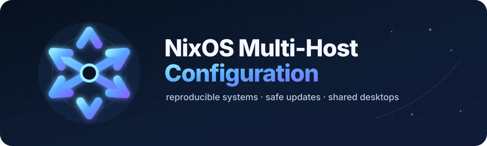

<p align="center">
  
</p>

<p align="center">
  Reproducible NixOS for two machines. Everything optional is a feature you switch on and off, app configuration syncs through Git with a live switch, games run in a sandbox, and AI agents live in a VM.
</p>

## Systems

| Host | Hardware | Default desktop |
|---|---|---|
| `nyx` | AMD desktop, `znver4` | Mango + Noctalia |
| `aether` | Intel/NVIDIA laptop, PRIME | Mango + Noctalia |

## Install

Start from a minimal NixOS with networking, Git, Nix and `sudo`.

```bash
nix run --refresh github:madebycli/nix-config#install -- --nyx
nix run --refresh github:madebycli/nix-config#install -- --aether
```

The installer clones to `~/nix-config`, copies this machine's own
`hardware-configuration.nix` over the tracked placeholder (kept local with
`skip-worktree`, never committed), builds, shows what changes and activates only
after you confirm. It never runs `nix flake update`;
versions come from the committed `flake.lock`.

The default checkout path is `~/nix-config` (`my.repoPath`). If a host uses a
different path, set it in `hosts/<host>/features.nix`, for example
`my.repoPath = "/home/xxxxx/aether";` for an existing Aether checkout, and use
`--dir /home/xxxxx/aether` when installing there.

## Switching features

Each machine's switches live in `hosts/<host>/features.nix`, one line per feature:

```nix
my.features.gaming.enable = true;
my.features.agentbox.enable = false;
```

```bash
nixctl              # interactive list, space toggles, preview, confirm, switch
nixctl on ai        # edit one switch
nixctl desktop      # choose compositors (Mango / Niri / Hyprland) and shell
nixctl apply        # build, show the closure diff, activate
```

Desktop selection is three options, no per-combination profiles:

```nix
my.desktop.compositors = [ "mango" ];
my.desktop.defaultSession = "mango";
my.desktop.shell = "noctalia";   # "caelestia" only with [ "hyprland" ] alone
```

Both hosts default to Mango only with Noctalia. Their kernel switch is
`my.kernel = "cachyos";`; use `"latest"` for `pkgs.linuxPackages_latest`.
The unreachable CachyOS Attic cache is no longer configured. Missing substitutes
can cause local compilation; failed cache downloads may fall back to local builds.

| Feature | What it adds |
|---|---|
| `dots` | Git-based sync of app config with a live on/off switch |
| `gaming` | Steam, Proton, Wine, launchers, gamescope |
| `sandbox` | `gbox`: bubblewrap sandbox for games, Wine and untrusted programs |
| `agentbox` | Isolated VM for Claude Code and Codex |
| `plymouth` | Boot splash with themes switchable without a rebuild |
| `ai` | Local models (Ollama, Open WebUI), started on demand |
| `flatpak` | Flatpak with a declarative app list |

## Config sync between machines (`dots`)

App folders listed in `my.features.dots.apps` live in `config/<app>` and are
symlinked into `~/.config`. Editing a file edits the repository working tree.

```bash
dots status     # links, pending changes, auto-sync state
dots on         # commit, rebase and push automatically every 5 min
dots off        # stop; nothing happens in the background
dots sync       # one round now
dots adopt      # move existing ~/.config folders into the repository
```

A conflict aborts the rebase, switches auto-sync off and sends a notification.
Files over 5 MB are never committed.

## Sandbox for games and untrusted programs (`gbox`)

Flatpak-style portals are not enough for a random download, so `gbox` starts the
program in a bubblewrap sandbox with an empty home, no D-Bus, no host X11/Wayland
socket and no host network namespace.

```bash
gbox new chinagame --net none --ro ~/Downloads/game -- ./game
gbox run chinagame                    # offline
gbox run chinagame --net inet         # internet, no LAN/localhost
gbox new wine1 --net inet && gbox wine wine1 -- setup.exe
gbox new tool --display none --net lan -- ./cli-tool
gbox list | show NAME | edit NAME | rm NAME [--purge]
```

| Setting | Meaning |
|---|---|
| `--net none` | no network (default) |
| `--net inet` | internet only; RFC1918, loopback and link-local are dropped |
| `--net lan` | internet and local network |
| `--display gamescope` | the game talks to a gamescope running outside the sandbox, never to your compositor (default) |
| `--share P` / `--ro P` | extra folder, read-write or read-only; `$HOME`, `~/.ssh`, `~/.config` are refused |
| `--dev P` | single device node, e.g. one gamepad `/dev/input/eventN` |
| `--no-gpu` / `--no-audio` | software rendering / no sound (the PipeWire socket also exposes the microphone) |

Network modes use a private namespace fed by `pasta`, so a program cannot reach
your host's loopback services or abstract sockets. Declarative profiles with menu
entries: `my.features.sandbox.apps.<name> = { command = [ ... ]; net = "inet"; }`.

Limits: this is a user-namespace sandbox, not a VM. A kernel vulnerability can
break out of it; for code you consider hostile, use `agentbox` or a throwaway VM.

## Agent VM (`agentbox`)

A headless NixOS microVM with Claude Code and Codex. It sees one host folder
(`my.features.agentbox.workspace`, mounted at `/work`) and nothing else. The
host firewall lets it reach the internet but not your LAN or host services.

```nix
my.features.agentbox.enable = true;
my.features.agentbox.sshKeys = [ "ssh-ed25519 AAAA... you@host" ];
```

```bash
agentbox start      # boot the VM
agentbox code       # VSCodium connected to /work (installs Open Remote - SSH)
agentbox ssh        # shell; there: yolo-claude, yolo-codex
agentbox reset --yes
```

Log in to your agent accounts and to GitHub inside the VM (`gh auth login`,
preferably with a token limited to the repositories the agents may touch).

## Boot splash

```bash
sudo plmf theme list
sudo plmf theme set zoot      # Arknights-style terminal animation, applies on next boot
sudo plmf theme reset
```

Themes are bundled at build time (`pkgs/plymouth-themes`); the choice is a small
file on the EFI partition, so switching needs no rebuild. The LUKS prompt stays
on the console.

## Local AI and dev shells

```bash
ai on | off | ui | status       # Ollama (+ Open WebUI), never started at boot
nix develop .#ai-rocm           # llama.cpp + uv + huggingface-cli (ai-cpu, ai-cuda)
echo "use flake ~/nix-config#ai-cuda" > .envrc && direnv allow
```

## Maintenance (`nx`)

```bash
nx status           # instant overview
nx check            # which inputs have updates (~2 s, no downloads)
nx update           # update outdated inputs, build, diff, confirm, switch
nx switch           # rebuild this host after editing the config
nx pull             # fetch the repo, fast-forward only
nx gen | nx clean | nx rollback | nx optimise
```

See [UPDATES.md](UPDATES.md). Anything can be run with `--json` for tools.

## Layout

```text
flake.nix            inputs, hosts, packages, dev shells
modules/core/        always-on modules
modules/desktop/     compositors, shells, greeter, GPU
modules/features/    optional features (my.features.*)
hosts/<host>/        hardware facts + feature switches
pkgs/                nx, gbox, dots, nixctl, agentbox, plmf, themes
config/<app>/        synchronised app configuration
tests/               shell and VM tests (run in CI)
```

Host-specific hardware data, credentials and private user data must never be
committed. `ci-<host>` configurations exist only so CI can evaluate without
real hardware.
